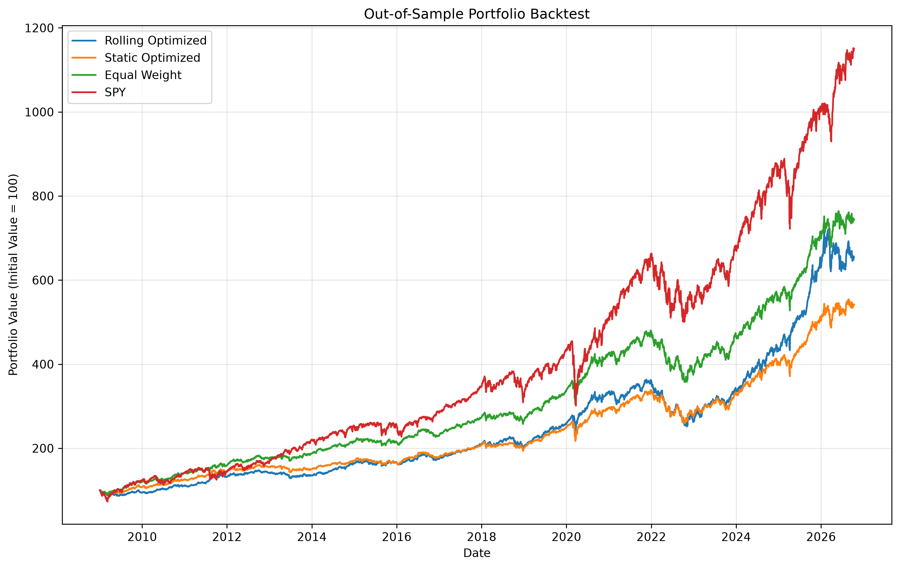
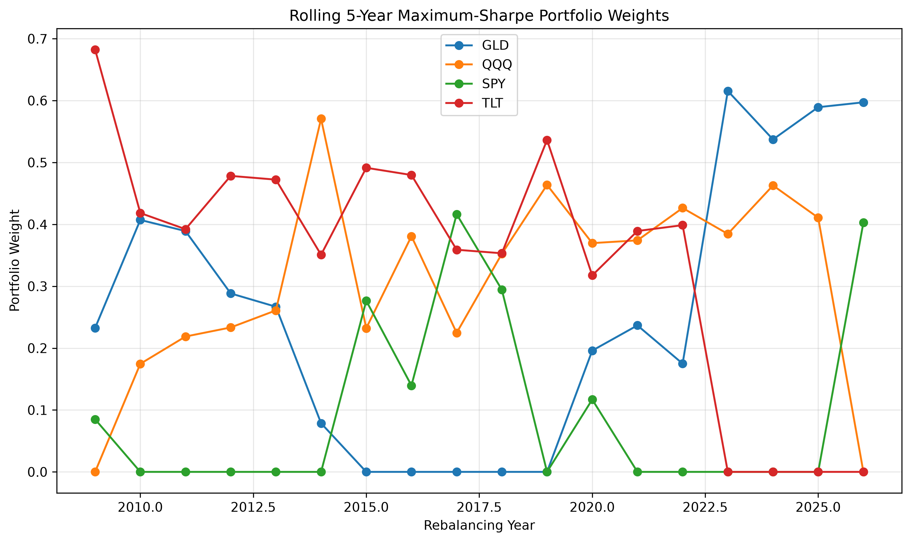
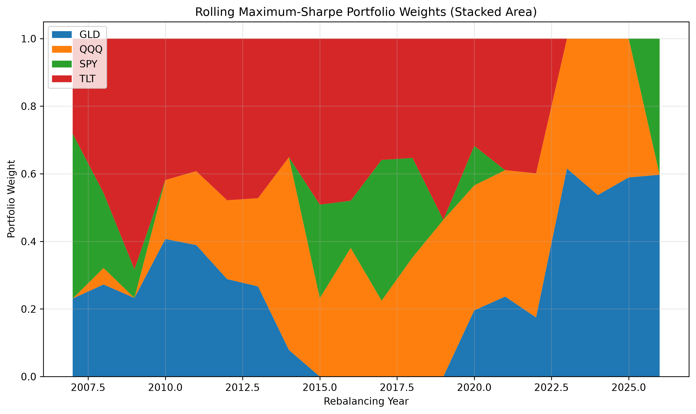
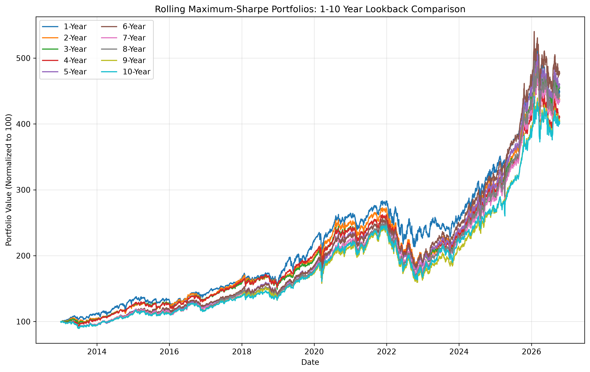
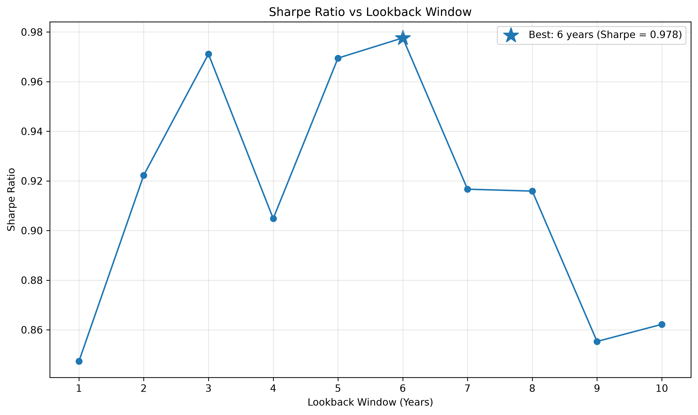
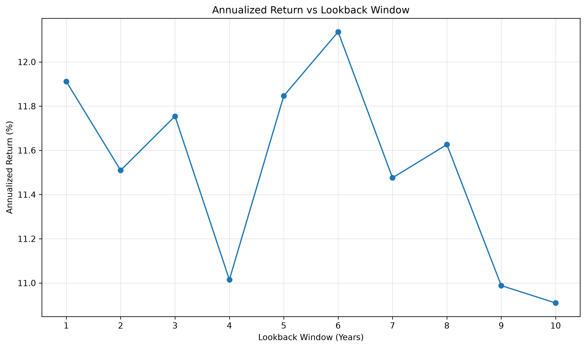
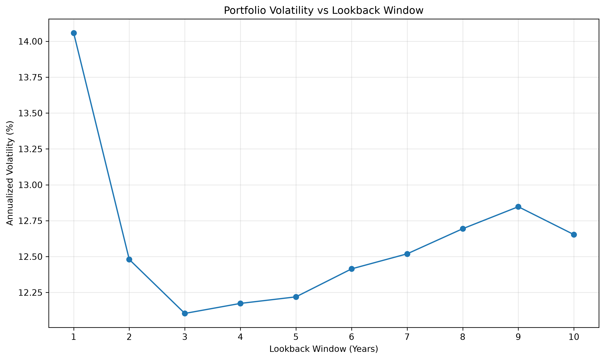
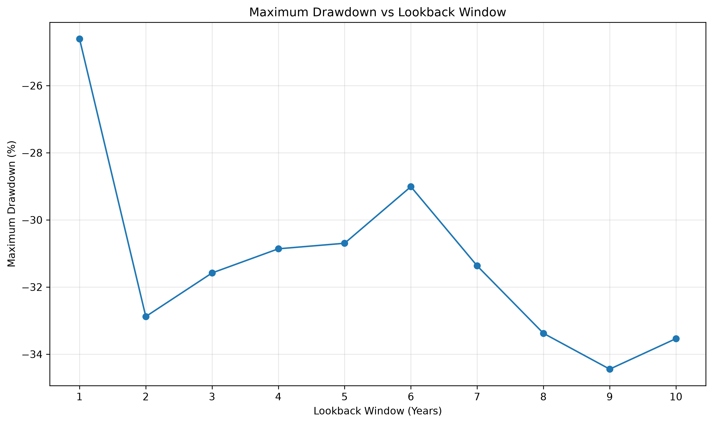

# Portfolio Backtesting and Rolling Optimization with Python

This project investigates how portfolio optimization performs when evaluated on **unseen historical data**, rather than on the same data used to construct the portfolio.

The project extends classical Markowitz mean-variance optimization into an out-of-sample backtesting framework and compares:

- Rolling maximum-Sharpe optimization
- Static maximum-Sharpe optimization
- Equal-weight annual rebalancing
- SPY buy-and-hold
- Rolling lookback windows from 1 to 10 years

The analysis uses four ETFs representing different asset classes:

- **SPY** — S&P 500
- **QQQ** — Nasdaq-100
- **TLT** — Long-term U.S. Treasury bonds
- **GLD** — Gold

---

## Objective

A portfolio can appear optimal when evaluated using the same historical observations that were used to construct it.

However,

$$
\text{in-sample optimal} \neq \text{out-of-sample optimal}
$$

The purpose of this project is therefore to separate the portfolio construction period from the subsequent evaluation period.

The basic workflow is:

$$
\text{Historical data}
\rightarrow
\text{Parameter estimation}
\rightarrow
\text{Optimization}
\rightarrow
\text{Future unseen data}
\rightarrow
\text{Performance evaluation}
$$

This allows the project to investigate:

- out-of-sample portfolio performance
- look-ahead bias
- rolling portfolio optimization
- annual rebalancing
- parameter sensitivity
- risk-adjusted performance
- robustness to the choice of historical lookback window

---

# Assets

The portfolio contains:

| Ticker | Asset |
|---|---|
| SPY | S&P 500 ETF |
| QQQ | Nasdaq-100 ETF |
| TLT | Long-term U.S. Treasury ETF |
| GLD | Gold ETF |

Only dates for which all assets have valid price observations are retained.

Prices are downloaded using `yfinance` with automatic adjustment enabled.

---

# Portfolio Theory

## Expected Portfolio Return

The expected portfolio return is

$$
\mu_p = w^T\mu
$$

where:

- $w$ is the vector of portfolio weights
- $\mu$ is the vector of estimated asset returns

---

## Portfolio Variance

Portfolio variance is

$$
\sigma_p^2 = w^T\Sigma w
$$

where $\Sigma$ is the covariance matrix of asset returns.

Portfolio volatility is therefore

$$
\sigma_p = \sqrt{w^T\Sigma w}
$$

The covariance terms allow the optimization to account for diversification between assets.

---

# Maximum-Sharpe Optimization

The optimizer selects portfolio weights by maximizing the Sharpe ratio:

$$
S = \frac{\mu_p-r_f}{\sigma_p}
$$

where:

- $\mu_p$ is expected portfolio return
- $r_f$ is the risk-free rate
- $\sigma_p$ is portfolio volatility

The optimization is performed using SciPy's **Sequential Least Squares Programming (SLSQP)** algorithm.

Because `scipy.optimize.minimize()` performs minimization, the code minimizes

$$
-S
$$

which is equivalent to maximizing the Sharpe ratio.

---

## Constraints

The optimized portfolios are fully invested:

$$
\sum_i w_i = 1
$$

and short selling is not allowed:

$$
0 \leq w_i \leq 1
$$

The current implementation uses

$$
r_f = 0
$$

as a simplifying educational assumption.

---

# Strategies

## 1. Rolling Maximum-Sharpe Portfolio

The main rolling strategy uses a **5-year historical lookback window**.

At the beginning of each year:

1. Only the previous five years of returns are selected.
2. Mean returns are estimated.
3. The covariance matrix is estimated.
4. Maximum-Sharpe weights are calculated.
5. The portfolio is rebalanced.
6. The resulting positions are held throughout the year.

The process is repeated every year.

Conceptually:

```text
Past 5 years
      ↓
Estimate returns and covariance
      ↓
Maximum-Sharpe optimization
      ↓
Invest during following year
      ↓
Repeat
```

The optimizer never uses observations from the year it is attempting to predict.

---

## 2. Static Maximum-Sharpe Portfolio

The static portfolio is optimized once using only historical information available **before the beginning of the backtest**.

The resulting allocation is then kept unchanged throughout the entire test period.

This provides a comparison between:

$$
\text{static optimization}
$$

and

$$
\text{adaptive rolling optimization}
$$

---

## 3. Equal-Weight Portfolio

The equal-weight strategy allocates:

$$
25\%
$$

to each ETF:

$$
w =
(0.25,\;0.25,\;0.25,\;0.25)
$$

The portfolio is rebalanced annually.

During each year, the number of shares remains unchanged, allowing the portfolio weights to drift naturally as asset prices change.

---

## 4. SPY Buy-and-Hold

SPY is used as a passive U.S. equity benchmark.

An initial investment is made at the beginning of the backtest and then held for the entire period.

---

# Buy-and-Hold Between Rebalances

After portfolio weights are determined, the capital invested in each asset is

$$
C_i = w_iV_0
$$

The number of shares purchased is

$$
N_i =
\frac{w_iV_0}{P_{i,0}}
$$

where:

- $V_0$ is portfolio value at the beginning of the period
- $P_{i,0}$ is the initial asset price
- $w_i$ is the portfolio weight

The number of shares remains constant until the following rebalance.

---

# Performance Metrics

Each strategy is evaluated using several risk and return measures.

## Annualized Return

Daily arithmetic returns are annualized as

$$
\mu_{\text{annual}} = 252\,E[r_d]
$$

---

## Annualized Volatility

$$
\sigma_{\text{annual}} = \sqrt{252}\,\sigma_d
$$

---

## Sharpe Ratio

$$
S = \frac{\mu-r_f}{\sigma}
$$

---

## Total Return

$$
R_{\text{total}} =
\frac{V_{\text{final}}}{V_{\text{initial}}}-1
$$

---

## Drawdown

At time $t$,

$$
D_t =
\frac{V_t}{\max_{\tau \leq t}V_\tau}-1
$$

Maximum drawdown corresponds to the largest historical decline from a previous portfolio peak.

---

# Lookback-Window Robustness Study

A central part of the project investigates how sensitive rolling maximum-Sharpe optimization is to the amount of historical data used for parameter estimation.

The rolling strategy is repeated for lookback windows ranging from:

$$
1,2,3,\ldots,10\text{ years}
$$

For every lookback window, exactly the same procedure is performed:

$$
\text{Previous }N\text{ years}
\rightarrow
\mu,\Sigma
\rightarrow
\text{Maximum-Sharpe portfolio}
\rightarrow
\text{Following year}
$$

The strategies are then restricted to their **common available evaluation period** and normalized to an initial value of 100.

This ensures that performance differences are not caused simply by one strategy having a longer backtest period than another.

---

# Lookback Sensitivity Results

The lookback analysis produced the following results during development:

| Lookback | Annual Return | Volatility | Sharpe | Total Return | Max Drawdown |
|---:|---:|---:|---:|---:|---:|
| 1 year | 11.77% | 14.04% | 0.838 | 339.98% | -25.03% |
| 2 years | 11.44% | 12.46% | 0.918 | 332.84% | -32.32% |
| 3 years | 11.63% | 12.07% | 0.964 | 347.43% | -30.94% |
| 4 years | 10.96% | 12.15% | 0.903 | 307.65% | -30.17% |
| 5 years | 11.71% | 12.19% | 0.961 | 351.32% | -30.02% |
| **6 years** | **12.03%** | **12.39%** | **0.971** | **370.05%** | **-28.35%** |
| 7 years | 11.39% | 12.48% | 0.912 | 329.58% | -30.80% |
| 8 years | 11.53% | 12.66% | 0.911 | 336.95% | -32.75% |
| 9 years | 10.86% | 12.80% | 0.848 | 297.11% | -33.99% |
| 10 years | 10.81% | 12.62% | 0.857 | 296.03% | -33.09% |

The highest Sharpe ratio was obtained using a **6-year lookback window**:

$$
S_{6y}=0.971
$$

with:

$$
R_{6y}=12.03\%
$$

and

$$
\sigma_{6y}=12.39\%
$$

However, the result should not be interpreted as proof that six years is universally optimal.

The 3-year and 5-year windows produced very similar Sharpe ratios:

$$
S_{3y}=0.964
$$

$$
S_{5y}=0.961
$$

This suggests a broader region of relatively strong performance around intermediate historical windows rather than a single sharply isolated optimum.

---

# Interpretation of Lookback Length

Very short estimation windows respond quickly to recent market behavior but use relatively few observations.

This can increase estimation noise in:

$$
\mu
$$

and

$$
\Sigma
$$

and therefore make optimized portfolio weights less stable.

Longer windows use more observations and can produce more stable statistical estimates, but older observations may describe market regimes that are no longer representative.

The experiment therefore illustrates a trade-off between:

$$
\text{responsiveness}
\leftrightarrow
\text{statistical stability}
$$

For this dataset, intermediate lookback windows generally produced stronger risk-adjusted performance than either very short or very long windows.

---

# Main Observations

The project highlights several important quantitative-finance concepts.

### In-sample optimization does not guarantee future performance

Portfolio weights estimated from historical data can perform very differently when applied to unseen observations.

### Rolling optimization can adapt to changing regimes

Re-estimating portfolio parameters periodically allows allocations to respond to changes in correlations, volatility, and historical returns.

### Optimization is sensitive to estimation choices

Changing the historical lookback period changes:

- expected returns
- covariance estimates
- portfolio weights
- risk-adjusted performance

### More historical data is not necessarily better

A longer historical sample produces more observations but may include market regimes that are less relevant to the current environment.

### Simpler strategies remain important benchmarks

Equal-weight allocation and passive SPY exposure provide useful reference points when evaluating whether a more complex optimization procedure actually adds value.

### Higher return does not necessarily mean better performance

Portfolio evaluation must consider both return and risk.

---

# Figures

## Out-of-Sample Strategy Comparison



Compares:

- rolling maximum-Sharpe
- static maximum-Sharpe
- equal weight
- SPY buy-and-hold

---

## Rolling Portfolio Weights



Shows how maximum-Sharpe portfolio allocations change between annual rebalancing dates.

---

## Rolling Allocation — Stacked View



Shows the complete portfolio composition through time.

---

## Portfolio Value vs Lookback Window



Compares the cumulative performance of rolling strategies using historical windows from 1 to 10 years.

---

## Sharpe Ratio vs Lookback Window



Shows the sensitivity of risk-adjusted performance to the historical estimation window.

The best historical Sharpe ratio in the tested range occurred at six years.

---

## Annualized Return vs Lookback Window



---

## Volatility vs Lookback Window



---

## Maximum Drawdown vs Lookback Window



---

# Generated Numerical Results

The script automatically stores numerical results in the `results/` directory.

```text
results/
├── performance_comparison.csv
├── rolling_optimized_weights.csv
├── portfolio_values.csv
├── lookback_robustness.csv
└── lookback_portfolio_values.csv
```

### `performance_comparison.csv`

Contains performance statistics for:

- rolling optimized portfolio
- static optimized portfolio
- equal-weight portfolio
- SPY

### `rolling_optimized_weights.csv`

Contains the annual optimized portfolio allocation for the main rolling strategy.

### `portfolio_values.csv`

Contains the complete portfolio-value history for the main strategy comparison.

### `lookback_robustness.csv`

Contains performance statistics for lookback windows from 1 to 10 years.

### `lookback_portfolio_values.csv`

Contains the portfolio-value histories used in the lookback robustness analysis.

---

# Repository Structure

```text
backtesting-portfolio-analysis/
│
├── backtesting_portfolio_analysis.py
├── README.md
├── requirements.txt
├── .gitignore
│
├── figures/
│   ├── out_of_sample_backtest.png
│   ├── rolling_weights_lines.png
│   ├── rolling_weights_stacked.png
│   ├── lookback_portfolio_comparison.png
│   ├── lookback_vs_sharpe.png
│   ├── lookback_vs_return.png
│   ├── lookback_vs_volatility.png
│   └── lookback_vs_drawdown.png
│
└── results/
    ├── performance_comparison.csv
    ├── rolling_optimized_weights.csv
    ├── portfolio_values.csv
    ├── lookback_robustness.csv
    └── lookback_portfolio_values.csv
```

---

# Technologies

- Python
- NumPy
- pandas
- Matplotlib
- SciPy
- yfinance

---

# Installation

Clone the repository:

```bash
git clone https://github.com/amraso/backtesting-portfolio-analysis.git
```

Enter the project directory:

```bash
cd backtesting-portfolio-analysis
```

Create a virtual environment:

```bash
python3 -m venv .venv
```

Activate it:

```bash
source .venv/bin/activate
```

Install dependencies:

```bash
pip install -r requirements.txt
```

Run the analysis:

```bash
python backtesting_portfolio_analysis.py
```

---

# Requirements

`requirements.txt`:

```text
numpy
pandas
matplotlib
scipy
yfinance
```

---

# Limitations

This project is an educational implementation of portfolio optimization and historical backtesting.

Important limitations include:

- historical mean returns are used as estimates of expected returns
- covariance estimates are based entirely on historical observations
- portfolio optimization is sensitive to estimation error
- transaction costs are ignored
- bid-ask spreads are ignored
- taxes are ignored
- market impact is ignored
- annual rebalancing is assumed to occur without cost
- the risk-free rate is fixed at zero
- short selling is not allowed
- only four ETFs are included
- the universe of assets is fixed
- the historical lookback study represents a parameter sensitivity analysis, not proof of an optimal future parameter
- historical performance does not imply future performance

---

# Possible Extensions

Possible future developments include:

- time-dependent risk-free rates
- transaction costs
- portfolio turnover analysis
- monthly or quarterly rebalancing
- expanding-window estimation
- additional asset classes
- minimum-variance optimization
- volatility targeting
- Sortino ratio
- Value at Risk
- Expected Shortfall
- covariance shrinkage
- robust optimization
- Black-Litterman models
- walk-forward parameter selection
- nested out-of-sample testing

---

## Disclaimer

This repository is intended for educational and quantitative-finance research purposes only.

It does not constitute financial or investment advice.
